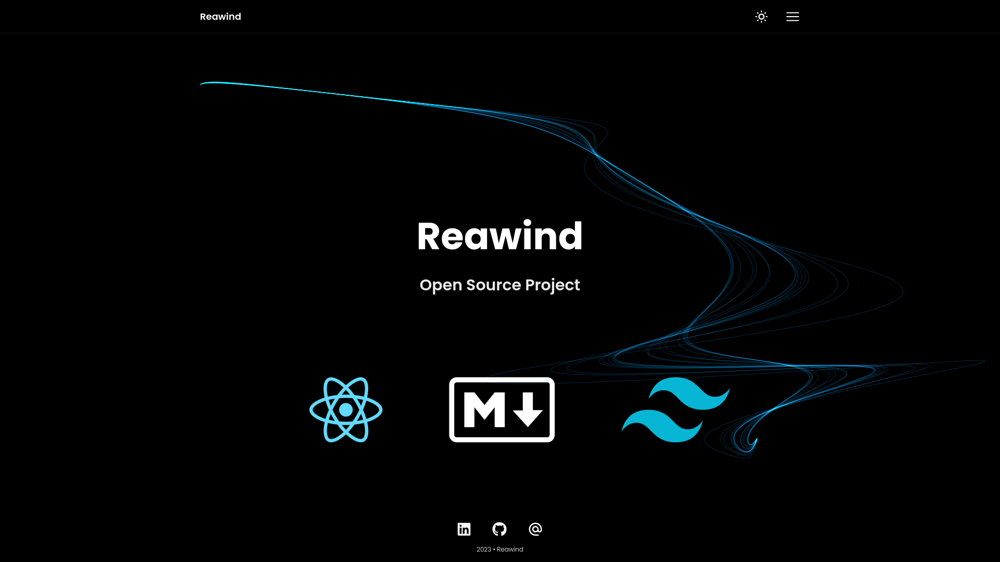

# Reawind Open Source Project

## Purpose

reawind is an open source project that allows users to quickly create a ready-made blog and portfolio site. This project was developed using technologies such as React, TypeScript, Tailwind and Markdown.

## Usage

To use reawind, you must first have Node.js installed on your computer. You can then follow the steps below:

### Step 1

Clone or download reawind repository. You can start here;

```bash
git clone https://github.com/gokhangunduz/reawind
```

### Step 2

Run this command to download the packages the project depends on.

```bash
npm install
```

### Step 3

Run the following command to start the project

```bash
npm start
```

### Step 4

Copy `.env.example` to `.env` and fill in your keys. The contact form needs them, without them it shows a "not configured" notice instead of sending.

| Variable                        | Description                          |
| ------------------------------- | ------------------------------------ |
| `REACT_APP_RECAPTCHA_SITE_KEY`  | Google reCAPTCHA v2 site key         |
| `REACT_APP_EMAILJS_SERVICE_ID`  | EmailJS service id                   |
| `REACT_APP_EMAILJS_TEMPLATE_ID` | EmailJS template id                  |
| `REACT_APP_EMAILJS_PUBLIC_KEY`  | EmailJS public key                   |

## Customize

- `src/templates/template.ts`: your name, title, contact details, social links, SEO texts and feature flags (for example `features.disableRightClick`).
- `src/templates/posts.ts` and `src/templates/projects.ts`: list your blog posts and projects. Every entry points to a markdown file in `public/markdown` and a cover image in `public/image`.
- The resume page renders the `README.md` of your GitHub profile repository, configured under `pages.resume` in `template.ts`.

## Scripts

| Command             | Description                                                           |
| ------------------- | --------------------------------------------------------------------- |
| `npm start`         | Start the development server                                          |
| `npm run watch`     | Rebuild `public/css/style.css` with Tailwind whenever classes change |
| `npm run build:css` | Rebuild the stylesheet once                                           |
| `npm run typecheck` | Run the TypeScript compiler without emitting files                    |
| `npm run build`     | Create the production build                                           |

Tailwind output is committed in `public/css/style.css`, so run `npm run build:css` after adding new utility classes.

## Contribute

reawind is an open source project and has a repository on GitHub. It is recommended that the project be forked and run on their local machine by developers willing to contribute. They can then create a pull request to push their changes back to the main repository.

The reawind project's GitHub page provides more information about the project's purpose, usage, and contributing guidelines. Developers who want to contribute to the project can follow the steps on this page.

Also, if you have any questions or suggestions about the project, you can reach the project managers using the contact information available on the GitHub page. Project managers are open to users' feedback and suggestions and will do their best to help improve the project.
